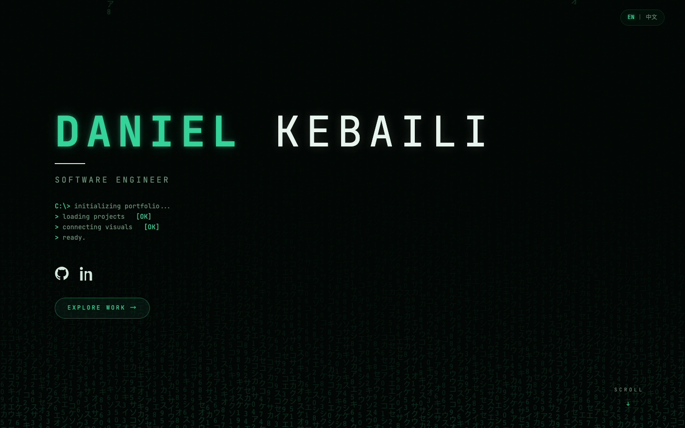
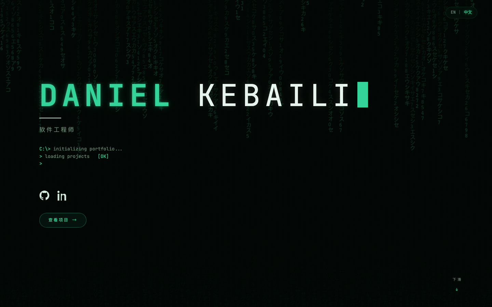

# Portfolio

Personal portfolio — matrix/terminal aesthetic, fully static SvelteKit site.

## Stack

- **SvelteKit 3 + Svelte 5** (runes), prerendered with `adapter-static` — no server, single `build/` output
- **Vite 8**, **Vitest** (35 unit tests), **svelte-check** for type gates
- **TypeScript** via JSDoc (`checkJs`), no `.ts` files
- Deployed on **Vercel**, CI gate via **GitHub Actions** (check + test + build on every PR)

## Features

- **Matrix rain** — hand-rolled canvas renderer (`src/lib/rain.js`), frame-skipped for a slower fall, pauses on hidden tab, renders a single static frame under `prefers-reduced-motion`
- **Scramble text** — headings and bio resolve from random katakana/ASCII on scroll into view (`src/lib/scramble.js`)
- **EN / 简体中文 toggle** — client-side i18n (`src/lib/i18n.svelte.js`): zh auto-detected from `navigator.language`, choice persisted to localStorage, sections remount and re-scramble on switch, `<html lang>`/title/meta swap, flash-guard inline script hides the page until the stored language applies
- **Contact form** — Web3Forms API with honeypot, input sanitization + length caps, strict email validation (`src/lib/form.js`), errors announced via `role="alert"`
- **Security headers** — CSP in hash mode (inline hydration script hashed), `X-Content-Type-Options`, `Referrer-Policy`, `X-Frame-Options`
- **Self-hosted JetBrains Mono** via Fontsource — no third-party font request

## Develop

    npm install
    npm run dev

## Build & test

    npm test        # vitest
    npm run check   # svelte-check
    npm run build   # outputs static site to build/

## Deploy

Push to GitHub; Vercel builds `main` automatically (zero config — detects
SvelteKit; build `npm run build`, output `build`).

## Content

- Projects: `src/lib/data/projects.json` (`description_zh` holds the Chinese
  copy; `npm run sync-projects` reports drift from GitHub, never rewrites)
- Links/stack: `src/lib/data/site.config.js`
- Translatable copy: `src/lib/i18n.svelte.js` (en/zh dictionaries — a parity
  test enforces identical keys and shapes)
